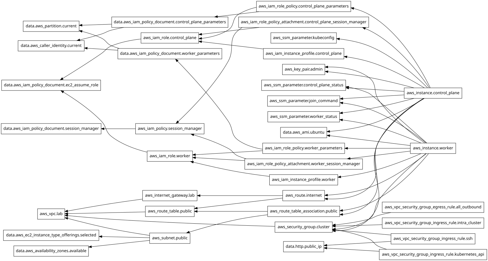

# AWS / kubeadm

> **Step 1 of 8: Build the cluster** · Run from `AWS/kubeadm/` · Needs: an AWS account and the tools in section 1\
> [All steps](../../README.md#learning-path) · Next: step 2, [Networking on a three-tier app](k8/README.md) · Step 8, [Tear down](#10-destroy), is section 10 of this page

A disposable two-node Kubernetes cluster on AWS for CKA and CKS practice,
built with `kubeadm` on plain EC2 — no EKS, no managed control plane, so
every component is yours to inspect and break.

Terraform builds the infrastructure; EC2 cloud-init installs and configures
Kubernetes inside the instances. There are no local scripts — the whole
workflow is `terraform init / plan / apply / destroy` plus a few `aws` and
`kubectl` commands, and it works identically from Windows PowerShell, Windows
Command Prompt, macOS, and Linux. You do not need Bash, WSL, or Git Bash.

Lab layout:

```text
AWS/kubeadm/        the Terraform project — terraform/aws commands run here
AWS/kubeadm/k8/     the lessons you run on the built cluster (steps 2-7 of the learning path)
```

```text
                         your computer
                 kubectl / aws cli / terraform
                              |
                              | TCP 6443 + SSM (HTTPS)
                              v
   +----------------------- AWS VPC 10.0.0.0/16 ------------------------+
   |                     public subnet 10.0.1.0/24                      |
   |                                                                    |
   |   master (10.0.1.10)                   worker (10.0.1.11)          |
   |   Ubuntu 24.04, t3.medium              Ubuntu 24.04, t3.medium     |
   |   kubeadm init, Calico, CoreDNS        kubeadm join                |
   |            \                              /                        |
   |             +--- SSM Parameter Store ----+                         |
   |               status / join-command / kubeconfig                   |
   +--------------------------------------------------------------------+
```


**What gets installed on the nodes:** containerd (systemd cgroups), kubeadm /
kubelet / kubectl from `pkgs.k8s.io` (v1.33 by default), Calico (v3.30.2 by
default, via the Tigera operator) so NetworkPolicy actually enforces, crictl
configured for containerd, and the `conntrack` CLI (used heavily by the
lessons in [`k8/`](k8/README.md)). The nodes register as `master` and
`worker`.

**How the nodes coordinate:** the control plane runs `kubeadm init`, then
publishes its status, a `kubeadm join` command, and a kubeconfig to SSM
Parameter Store. The worker polls the status parameter, and joins once it
reads `ready`. Terraform resource ordering is never relied on for this.

**Cost:** two `t3.medium` instances ≈ $0.09/hour plus a few cents of EBS and
one Advanced-tier SSM parameter ($0.05/month, prorated); ≈ $0.21/hour with
a `t3.xlarge` worker (section 3). Run `terraform destroy` the moment you stop
practicing.

---

**Contents**

1. [Prerequisites](#1-prerequisites)
2. [Authenticate to AWS](#2-authenticate-to-aws)
3. [Create terraform.tfvars](#3-create-terraformtfvars)
4. [Deploy](#4-deploy)
5. [Watch the bootstrap](#5-watch-the-bootstrap)
6. [Retrieve the kubeconfig](#6-retrieve-the-kubeconfig)
7. [Verify the cluster](#7-verify-the-cluster)
8. [Shell access to the nodes](#8-shell-access-to-the-nodes)
9. [Troubleshooting](#9-troubleshooting)
10. [Destroy](#10-destroy)

Also: [Design notes, assumptions, and limitations](#design-notes-assumptions-and-limitations) · [Variable reference](#variable-reference)

---

## 1. Prerequisites

Install these on your computer (all have Windows, macOS, and Linux builds):

| Tool | Why | Install |
|---|---|---|
| Terraform ≥ 1.6 | builds the infrastructure | <https://developer.hashicorp.com/terraform/install> |
| AWS CLI v2 | auth, kubeconfig retrieval, status checks | <https://docs.aws.amazon.com/cli/latest/userguide/getting-started-install.html> |
| Session Manager plugin | shell access to nodes without SSH | <https://docs.aws.amazon.com/systems-manager/latest/userguide/session-manager-working-with-install-plugin.html> |
| kubectl | talk to your cluster | <https://kubernetes.io/docs/tasks/tools/> |

Verify:

```text
terraform version
aws --version
session-manager-plugin
kubectl version --client
```

## 2. Authenticate to AWS

Use whatever your AWS account normally uses — this project relies on the
standard AWS credential chain and never stores credentials:

- `aws configure` (access key + secret key), or
- `aws configure sso` + `aws sso login`, or
- environment variables (`AWS_ACCESS_KEY_ID`, `AWS_SECRET_ACCESS_KEY`, ...).

Your identity needs rights to manage VPC, EC2, IAM roles/policies, and SSM
parameters (`AdministratorAccess` or similar in a training account is fine).

Verify:

```text
aws sts get-caller-identity
```

If you use a **named profile**, set `aws_profile` in `terraform.tfvars`; every
command printed by `terraform output` will then include `--profile` for you.

## 3. Create terraform.tfvars

Move into this lab's directory — every `terraform` and `aws` command from
here on runs inside it:

```text
cd AWS/kubeadm
```

Copy the example file:

```text
Windows PowerShell:  Copy-Item terraform.tfvars.example terraform.tfvars
Windows cmd:         copy terraform.tfvars.example terraform.tfvars
macOS / Linux:       cp terraform.tfvars.example terraform.tfvars
```

One value is required: the single public IP allowed to reach the API server
(and SSH, if you enable it). Set it automatically as below, or by hand in the
next subsection.

If your IP changes — home ISP, VPN, tethering — a stale `admin_cidr` does not
announce itself. The security group simply drops your packets and `kubectl`
hangs with no error. To have Terraform look the IP up on every plan instead,
comment out `admin_cidr` and set:

```hcl
auto_detect_admin_cidr = true
```

Terraform then fetches <https://checkip.amazonaws.com> at plan time and uses
that address with a `/32`. A changed IP becomes a visible one-line diff:

```text
~ cidr_ipv4 = "198.51.100.7/32" -> "203.0.113.25/32"
Plan: 0 to add, 2 to change, 0 to destroy.
```

Set one or the other, not both — Terraform stops with an error if you set
`admin_cidr` while auto-detection is on, rather than silently picking a
winner. The lookup is checked before it is used: a non-200 response or
anything that is not a bare IPv4 address fails the plan instead of becoming a
security-group rule. This adds the `hashicorp/http` provider (so re-run
`terraform init`) and requires outbound HTTPS at plan time, which is why it is
opt-in rather than the default.

### Optional: Manually find your IP

Instead of auto-detection, edit `terraform.tfvars` and set `admin_cidr` to **your public IP** with
`/32`. Find your public IP by opening <https://checkip.amazonaws.com> in a
browser, or:

```text
Windows PowerShell:  (Invoke-WebRequest -Uri "https://checkip.amazonaws.com").Content.Trim()
Windows cmd:         curl https://checkip.amazonaws.com
macOS / Linux:       curl https://checkip.amazonaws.com
```

Example: if your IP is `198.51.100.7`, set `admin_cidr = "198.51.100.7/32"`.
Only this CIDR can reach the Kubernetes API (and SSH, if you enable it) —
nothing is exposed to `0.0.0.0/0`. A `/32` is the only accepted form; wider
prefixes are rejected, so a slip cannot quietly widen who can reach the API.

### Optional: a bigger worker for the webshop

Step 6 of the [learning path](../../README.md#learning-path), networking on
the webshop, adds an Ingress controller and Envoy Gateway to the worker,
which leaves a `t3.medium` little headroom. If you will do it, uncomment this
line in `terraform.tfvars`:

```hcl
worker_instance_type = "t3.xlarge"
```

Everything else fits the default. Setting it on a running lab works too:
`terraform apply` then resizes the worker in place (about two minutes; same
disk, private IP and node name, new public IP).

## 4. Deploy

From the `AWS/kubeadm/` directory:

```text
terraform init
terraform validate
terraform plan
terraform apply
```

Type `yes` when prompted. The infrastructure appears in ~2 minutes; the
instances then spend **5–10 minutes** installing Kubernetes on first boot.
`terraform apply` finishing does **not** mean the cluster is ready yet.

## 5. Watch the bootstrap

Print the ready-made status commands and run them (they are plain `aws`
commands and work in every shell):

```text
terraform output bootstrap_status_commands
```

Each node moves through `pending → bootstrapping → ready`. You are done
waiting when **both** commands print `ready` — typically the control plane
after ~5 minutes and the worker ~2 minutes later. If either prints `failed`,
jump to Troubleshooting.

To watch a node's progress live, open a shell on it (section 8) and run:

```text
cloud-init status --long
sudo tail -f /var/log/cloud-init-output.log
sudo tail -f /var/log/k8s-bootstrap.log
```

## 6. Retrieve the kubeconfig

The control plane publishes a cluster-admin kubeconfig to SSM Parameter Store
(as a SecureString), pointing at `https://<control-plane-public-ip>:6443`.
The API server certificate includes the public IP, so kubectl works from your
computer without any tweaks.

`terraform output kubeconfig_retrieval_commands` prints these with the real
parameter name and region filled in:

**Windows PowerShell** (`Set-Content -Encoding ascii` keeps the multi-line
YAML intact and avoids a byte-order mark):

```powershell
aws ssm get-parameter --name /kubeadm-lab/kubeconfig --with-decryption --query Parameter.Value --output text --region us-east-1 | Set-Content -Path .\kubeadm-lab.kubeconfig -Encoding ascii
$env:KUBECONFIG = "$PWD\kubeadm-lab.kubeconfig"
```

**Windows Command Prompt:**

```bat
aws ssm get-parameter --name /kubeadm-lab/kubeconfig --with-decryption --query Parameter.Value --output text --region us-east-1 > kubeadm-lab.kubeconfig
set KUBECONFIG=%CD%\kubeadm-lab.kubeconfig
```

**macOS / Linux:**

```bash
aws ssm get-parameter --name /kubeadm-lab/kubeconfig --with-decryption --query Parameter.Value --output text --region us-east-1 > kubeadm-lab.kubeconfig
export KUBECONFIG="$PWD/kubeadm-lab.kubeconfig"
```

Writing to a dedicated file (instead of `~/.kube/config`) keeps any existing
kubeconfig untouched. Now:

```text
kubectl get nodes -o wide
```

## 7. Verify the cluster

**Nodes and system Pods** (worker may take a minute or two after joining to
become `Ready` while Calico images pull):

```text
kubectl get nodes -o wide                 # both nodes Ready
kubectl get pods -n kube-system           # coredns 2/2 Running
kubectl get pods -n calico-system         # calico-node Running on BOTH nodes
kubectl get tigerastatus                  # calico: AVAILABLE True
```

Both nodes `Ready` and Calico `AVAILABLE`: the cluster is built. **Next:**
step 2, [Networking on a three-tier app](k8/README.md), or any step in the
[learning path](../../README.md#learning-path).

## 8. Shell access to the nodes

**Session Manager (default, no SSH, no open ports needed):**

```text
terraform output session_manager_commands
```

Run the printed command, e.g.
`aws ssm start-session --target i-0abc... --region us-east-1`. You land as
`ssm-user`; switch to the regular user:

```text
sudo su - ubuntu
kubectl get nodes        # works on the control plane; alias 'k' is set up too
```

Type `exit` twice to leave. If the session is refused right after apply, wait
a minute — the SSM agent registers during first boot.

**Optional SSH.** Set in `terraform.tfvars`:

```hcl
ssh_enabled         = true
ssh_public_key_path = "~/.ssh/id_ed25519.pub"
```

Run `terraform apply` again, then `terraform output ssh_commands`. The
printed commands are ready to run: the `-i` key path is derived from
`ssh_public_key_path` by dropping the `.pub` suffix (so
`~/.ssh/id_ed25519_accountA.pub` yields `ssh -i ~/.ssh/id_ed25519_accountA ...`),
which is where OpenSSH keeps the matching private key. Only your existing
**public** key is uploaded; Terraform never generates or stores a private
key. (Windows 10/11 and macOS ship an OpenSSH client; generate a key with
`ssh-keygen -t ed25519` if you have none.)

SSH and Session Manager work side by side — enabling one does not disable the
other.

Note: EC2 key pairs are fixed at launch, so enabling SSH on an
already-running lab **replaces both instances** — you get a fresh cluster.
The plan will say `2 to replace`; that is expected.

## 9. Troubleshooting

**A status parameter shows `failed`, or stays `pending`/`bootstrapping` for
more than ~15 minutes.** Open a shell on that node (section 8) and read the
logs:

```text
cloud-init status --long
sudo tail -n 100 /var/log/cloud-init-output.log
sudo tail -n 100 /var/log/k8s-bootstrap.log
```

Almost every failure is visible there (a package mirror hiccup, a typo'd
version, etc.). The bootstrap script is idempotent-ish and can be re-run:
`sudo /opt/k8s-lab/bootstrap.sh`.

**kubelet problems:**

```text
systemctl status kubelet
sudo journalctl -u kubelet -f
```

A crash-looping kubelet *before* `kubeadm init`/`join` has run is normal — it
has no config yet. After init/join, look for cgroup or CNI messages.

**containerd problems:**

```text
systemctl status containerd
sudo crictl ps -a          # containers, including exited ones
sudo crictl pods           # pod sandboxes
sudo crictl images
```

`crictl` is preconfigured for containerd via `/etc/crictl.yaml`. If
`kubeadm init` complains about the CRI, check
`grep -E 'SystemdCgroup|sandbox_image' /etc/containerd/config.toml` and
`sudo systemctl restart containerd`.

**Worker never joins.** Check the worker status parameter and
`/var/log/k8s-bootstrap.log` on the worker. Common causes:

- *Control plane failed first* — the worker aborts if the control plane
  reports `failed`; fix the control plane first.
- *Join token expired* (tokens last 24 h; only relevant if you retry a join
  much later). On the control plane:
  `sudo kubeadm token create --print-join-command`, then run the printed
  command with `sudo` on the worker — or update the SSM parameter and re-run
  `sudo /opt/k8s-lab/bootstrap.sh` on the worker.
- *Already joined* — the script skips joining if
  `/etc/kubernetes/kubelet.conf` exists. To force a re-join:
  `sudo kubeadm reset -f`, then re-run the bootstrap script.

**kubectl from your computer times out.** Your public IP probably changed
(home ISPs rotate them, VPNs change them). The tell is that it *hangs* rather
than erroring — a dropped packet, not a refused connection. Confirm with the
same lookup from step 3, compare it to the rule that is live:

```text
aws ec2 describe-security-groups --group-ids <security_group_id> \
  --query "SecurityGroups[0].IpPermissions[?IpRanges[0]].{Port:FromPort,Cidr:IpRanges[0].CidrIp}" \
  --output table
```

then update `admin_cidr` in `terraform.tfvars` and run `terraform apply` —
only the security-group rules change, nothing is rebuilt, and the kubeconfig
you already downloaded keeps working. To stop hitting this, turn on
`auto_detect_admin_cidr` (step 3). Corporate networks that block outbound port
6443 cause the same symptom.

**A NodePort/Ingress port times out from your computer.** Expected: the
security group opens only 6443 (and 22 if SSH is enabled). NodePorts are
reachable *from a node*, not from your laptop, unless you open the range
yourself — see Module 5. A *hang* means a dropped packet (security group);
an instant "connection refused" means nothing is listening.

**kubectl says certificate is invalid for the IP.** The control-plane
instance was stopped and started, which changed its public IP; the API
certificate and stored kubeconfig still reference the old one. This lab is
disposable by design — recreate it (`terraform destroy` + `apply`), or
replace both instances:
`terraform apply -replace=aws_instance.control_plane -replace=aws_instance.worker`.

**Nodes `NotReady`.** Usually Calico still rolling out:
`kubectl get pods -n calico-system -w`. Give it a few minutes on first boot.

## 10. Destroy

```text
terraform destroy
```

Type `yes`. This removes everything the project created: both EC2 instances
and their EBS volumes, the IAM roles/policies/instance profiles, the security
group, all four SSM parameters (including the kubeconfig and join command),
the route table, internet gateway, subnet, and VPC. If the command errors
partway (rare, usually eventual-consistency), simply run it again.

Afterwards, delete the local `kubeadm-lab.kubeconfig` file — the cluster it
points at no longer exists.

## Design notes, assumptions, and limitations

- **Learning environment, not production.** Single control plane, etcd on the
  node, public subnet, no HA, no load balancer, cluster-admin kubeconfig for
  students.
- **Coordination via SSM Parameter Store.** Terraform creates and owns the
  four parameters (so destroy removes them) and ignores value drift; the
  instances overwrite the values at boot. The kubeconfig parameter uses the
  Advanced tier because admin kubeconfigs exceed the 4 KB standard limit.
- **Least-privilege node IAM.** The instances use a minimal custom Session
  Manager policy instead of `AmazonSSMManagedInstanceCore` (which would grant
  `ssm:GetParameter` on `*`). The control plane can read/write only
  `/<project>/*` parameters; the worker can only read the control-plane
  status + join command and write its own status. Worth inspecting for CKS.
- **AZ selection is automatic and defensive:** the subnet lands in the first
  standard availability zone that actually offers `instance_type`. Opted-in
  Local/Wavelength Zones and legacy AZs are excluded — they lack gp3 volumes
  or modern instance types.
- **Nodes are named `master` and `worker`** (cloud-init hostname + explicit
  kubeadm node names) instead of the default `ip-10-0-1-x` EC2 hostnames.
- **Static private IPs** (`.10`/`.11` in the subnet) let Terraform render
  user data before boot; the public IP is discovered at boot via IMDSv2 and
  added to the API server certificate SANs.
- **Calico via the Tigera operator, VXLAN encapsulation** — works in any VPC
  without touching source/dest checks, and NetworkPolicy enforcement is on.
- **IMDSv2 is required** with a hop limit of 1, so pods cannot reach the
  instance metadata service — itself a CKS talking point.
- **Versions:** `kubernetes_version` is a minor version (default `1.33`,
  minimum `1.31` because the bootstrap uses the kubeadm `v1beta4` config API);
  the newest patch of that minor is installed and held. Pick a
  `calico_version` that supports your Kubernetes minor (v3.30.x ↔ K8s
  1.31–1.33).
- **x86_64 only** (the AMI lookup is amd64); choose x86 instance types.
  Commercial AWS partition assumed (Canonical's AMI owner ID differs in
  GovCloud/China).
- **Join tokens live 24 h**; the worker joins within minutes, so this only
  matters for late manual retries.
- **Stopping instances breaks the public endpoint** (new public IP, stale
  cert/kubeconfig). Don't stop — destroy and recreate; that is the point of
  the lab.

## Variable reference

| Variable | Default | Purpose |
|---|---|---|
| `project_name` | `kubeadm-lab` | Resource-name and SSM-path prefix; unique per account |
| `aws_region` | `us-east-1` | Deployment region |
| `aws_profile` | `""` | Optional named CLI profile |
| `admin_cidr` | — (required unless auto-detecting) | Your IP as a `/32`; only source allowed to API + SSH. Wider prefixes rejected |
| `auto_detect_admin_cidr` | `false` | Look up your public IP at plan time instead of setting `admin_cidr` |
| `instance_type` | `t3.medium` | Both nodes' instance type (x86_64) |
| `worker_instance_type` | `null` (= `instance_type`) | The worker's instance type only; changing it later resizes the worker in place (stop/start: same disk and private IP, new public IP) |
| `root_volume_size_gb` | `30` | Encrypted gp3 root volume size |
| `ubuntu_release` | `24.04` | `22.04` or `24.04` |
| `kubernetes_version` | `1.33` | K8s minor version from pkgs.k8s.io (≥ 1.31) |
| `calico_version` | `v3.30.2` | Calico release tag for the operator manifest |
| `vpc_cidr` | `10.0.0.0/16` | Lab VPC CIDR |
| `subnet_cidr` | `10.0.1.0/24` | Public subnet CIDR |
| `pod_cidr` | `192.168.0.0/16` | Pod network (kubeadm + Calico IP pool) |
| `service_cidr` | `10.96.0.0/12` | Service network |
| `ssh_enabled` | `false` | Open port 22 from `admin_cidr` + install key pair |
| `ssh_public_key_path` | `""` | Existing public key file (required if SSH enabled) |

---

> [All steps](../../README.md#learning-path) · Next: step 2, [Networking on a three-tier app](k8/README.md)
