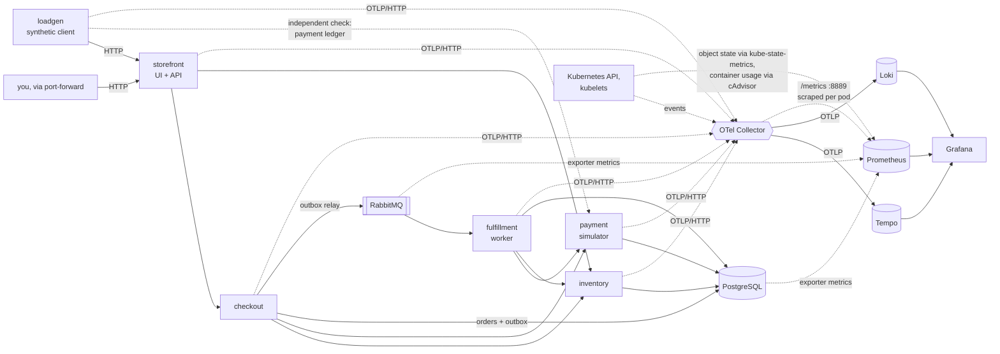
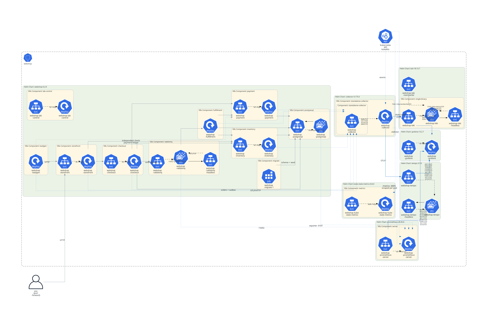

# Webshop observability lab: diagnose incidents from telemetry you already have

> **Steps 4–7 of 8: the webshop** · Run from `AWS/kubeadm/k8/webshop/` (the quick start begins in `AWS/kubeadm/`) · Needs: the cluster (step 1)\
> [All steps](../../../../README.md#learning-path) · Steps here: 4 [Install the webshop](#quick-start-on-the-aws-lab) · 5 [Incident and blind exercises](#5-incident-exercises) · 6 [Networking on the webshop](docs/networking.md) · 7 [OpenTelemetry](docs/opentelemetry.md)

> An application is properly instrumented when developers can troubleshoot an
> incident using telemetry already collected, without adding instrumentation
> and reproducing the incident.

This lesson builds a small but honest order-processing system on the AWS
kubeadm cluster, instruments it with OpenTelemetry, ships every signal through
an OpenTelemetry Collector into Prometheus, Loki and Tempo, and then breaks it
in eight repeatable ways (plus one deliberate safeguard bypass). You diagnose
each break in Grafana - first with a walkthrough, then blind, with the
instrumentation frozen.

It is a sibling of the signed `app` chart in [`../helm/`](../helm/README.md): same
cluster, same Helm, different question. The networking lessons ask *how does
a packet get there*; this one asks *how do you know what your users got*.



Solid arrows are requests: the shop's own traffic and, inside the telemetry
stack, the writes to the stores and Grafana's queries. Dotted arrows are
telemetry collected from the components and from Kubernetes, plus the
synthetic client's independent check of the payment ledger. `lab-control`, the
internal fault controller every pod polls, is left out of the picture on
purpose: it is not part of the system being observed.

**What's in this folder for you**

| You use | For |
|---|---|
| this README and [`docs/`](docs) | the lessons |
| `tools/lab.py` | faults, load, blind exercises and checks (`python3 tools/lab.py --help`) |
| [`networking/`](networking), [`otel/`](otel) | the files the networking and OpenTelemetry tracks apply and run |

In `docs/`, open `answer-key/` only after you have written your answer;
`reference.md` and `verification.md` are for maintainers. Everything else
builds and tests the shop, and you only read it where a lesson links to it
(the OpenTelemetry track shows code in `src/`): `src/` (the application),
`chart/` and `observability/` (the Helm chart), `values/` (install settings;
the quick start picks the right file), `tests/`, and the other scripts in
`tools/`. To change any of it, start with [docs/reference.md](docs/reference.md).

## Quick start on the AWS lab

The install, start to finish. [docs/install.md](docs/install.md) explains
what each step does and why, and covers the variations (your own image, a
private registry, a throwaway install, Windows). Every block runs as pasted,
top to bottom, in **one terminal** (bash or zsh on macOS/Linux): nothing to
fill in, and each step waits until the cluster is actually ready for the next.
For Windows, see the variants in section 1 and in
[AWS/kubeadm/README.md, section 6](../../README.md#6-retrieve-the-kubeconfig).

**1. Point kubectl at the lab.** From the repository root, after
`terraform apply` has finished:

```text
cd AWS/kubeadm
aws ssm get-parameter --name /kubeadm-lab/kubeconfig --with-decryption --query Parameter.Value --output text --region us-east-1 > kubeadm-lab.kubeconfig
export KUBECONFIG="$PWD/kubeadm-lab.kubeconfig"
kubectl wait --for=condition=Ready node --all --timeout=600s
kubectl get nodes
```

Expect `master` and `worker`, both `Ready`.

**2. Create the storage directories on the worker** ([why](docs/install.md#step-2-storage-directories-on-the-worker)). Still in
`AWS/kubeadm`; Session Manager runs the command on the worker and returns:

```text
aws ssm start-session --region "$(terraform output -raw aws_region)" --target "$(terraform output -raw worker_instance_id)" --document-name AWS-StartInteractiveCommand --parameters command="sudo mkdir -p /var/lib/webshop/postgresql /var/lib/webshop/rabbitmq /var/lib/webshop/prometheus /var/lib/webshop/loki /var/lib/webshop/tempo /var/lib/webshop/grafana && ls -ld /var/lib/webshop/*"
```

Expect six `drwxr-xr-x ... root root` lines, one per directory. The session
closes by itself afterwards (`Exiting session`, or `Cannot perform start
session: EOF` - both just mean the one command is done).

**3. Install metrics-server** ([why](docs/install.md#step-3-metrics-server)), which the HPAs need. A fresh lab
does not have it; on one that already does, this is a harmless upgrade:

```text
helm upgrade --install metrics-server metrics-server --repo https://kubernetes-sigs.github.io/metrics-server/ --version 3.14.0 -n kube-system --set "args[0]=--kubelet-insecure-tls"
kubectl -n kube-system rollout status deployment/metrics-server --timeout=180s
kubectl wait --for=condition=Available apiservice/v1beta1.metrics.k8s.io --timeout=180s
kubectl top nodes
```

Expect CPU and memory figures for `master` and `worker`.

**4. Install** ([what it does](docs/install.md#step-4-install)). From `AWS/kubeadm`, into the webshop directory -
every later command runs from there:

```text
cd k8/webshop
helm repo add open-telemetry https://open-telemetry.github.io/opentelemetry-helm-charts
helm repo add prometheus-community https://prometheus-community.github.io/helm-charts
helm repo add grafana-community https://grafana-community.github.io/helm-charts
helm dependency build ./chart
helm upgrade --install webshop ./chart -n webshop --create-namespace -f values/values-aws.yaml --wait --timeout 10m
kubectl -n webshop get pods
```

`--wait` makes Helm return only when every workload is ready - 3-5 minutes
the first time (image pulls, PostgreSQL `initdb`, the migration Job). Then
every pod is `Running`, and the `webshop-migrate-<revision>` pod `Completed`.
(`helm repo add` for a repository you already have just says it is skipping.)
The image is the public, prebuilt `docker.io/bleeng089/webshop:0.2.0`;
[building your own](docs/install.md#if-you-want-to-build-and-publish-your-own-image).

**5. Verify** ([what it checks](docs/install.md#step-5-verify)):

```text
helm test webshop -n webshop --logs
python3 tools/lab.py verify
python3 tools/lab.py check-dashboards
```

Expect `journey : good`, `0 failed` and `queries with errors: 0`.
`check-dashboards` runs every dashboard query against the live Prometheus
and Loki; an `empty` count is normal for panels whose condition is absent
(for example no pending pods).

**6. Open it** ([more](docs/install.md#step-6-open-the-shop-and-grafana)). First the Grafana password, in this terminal:

```text
python3 tools/lab.py grafana-password
```

A port-forward keeps running until you stop it, so each one gets a **new
terminal** - and a new terminal does not know the kubeconfig.
Open two, `cd` to this `webshop/` directory in each, and run one block in
each:

```text
export KUBECONFIG="$PWD/../../kubeadm-lab.kubeconfig"
kubectl -n webshop port-forward svc/webshop-storefront 8080:80
```

```text
export KUBECONFIG="$PWD/../../kubeadm-lab.kubeconfig"
kubectl -n webshop port-forward svc/webshop-grafana 3000:80
```

The shop is at <http://localhost:8080>; Grafana is at <http://localhost:3000>
(user `admin`, the password from above). Ctrl+C in a terminal ends its
port-forward. Next: the dashboards (section 3), then break
something (section 5). When you are done, `terraform destroy` in `AWS/kubeadm` (the lab
costs money while it runs; section 11 removes only the webshop).

---

**Contents**

- [Quick start on the AWS lab](#quick-start-on-the-aws-lab)

1. [Prerequisites](#1-prerequisites)
2. [What gets built](#2-what-gets-built)
3. [Dashboards and signal links](#3-dashboards-and-signal-links)
4. [What each signal contributes](#4-what-each-signal-contributes)
5. [Incident exercises](#5-incident-exercises)
6. [Blind exercises](#6-blind-exercises)
7. [Networking track](#7-networking-track)
8. [OpenTelemetry track](#8-opentelemetry-track)
9. [Scaling and capacity](#9-scaling-and-capacity)
10. [Troubleshooting](#10-troubleshooting)
11. [Cleanup](#11-cleanup)

For changing the chart or the code (values, tests, folder layout, versions,
limitations): [docs/reference.md](docs/reference.md).

---

## 1. Prerequisites

**A running AWS kubeadm lab.** Build it with [`AWS/kubeadm/`](../../README.md)
(sections 1-7: `terraform apply`, wait for both nodes `ready`, fetch the
kubeconfig) and point `KUBECONFIG` at the file exactly as that README shows.
This lesson never touches the Terraform project or the security group:
everything below reaches the cluster through the API server on 6443.

**On your computer** (Windows, macOS or Linux - nothing here needs Bash, WSL or Git Bash):

| Tool | Why |
|---|---|
| kubectl | talk to the cluster |
| Helm 3.8+ (written against v4.3) | install the chart |
| Python 3.10+ | the `tools/*.py` helpers (standard library only, no packages) |
| Docker with buildx, or Podman | build the application image (only if you change `src/`; [docs/install.md](docs/install.md#if-you-want-to-build-and-publish-your-own-image)) |
| A container registry account (Docker Hub, GHCR, ...) | the EC2 nodes pull your own image from there (same) |

**Command conventions.** Commands run from this `webshop/` directory unless
they say otherwise. Every `kubectl` command is written out in full, with the
namespace right after it (`kubectl -n webshop get pods`), so you can always
see which namespace a command acts on.

`python3` below is your Python 3 interpreter; on Windows it is usually `py`
(the launcher) instead.

Commands marked **[on the worker]** run on the `worker` node: open a shell
with `terraform output session_manager_commands` (or `ssh_commands`) from
`AWS/kubeadm/`, as in that README's section 8.

## 2. What gets built

| Component | Kind | Job |
|---|---|---|
| storefront | Deployment + HPA | Web UI and the JSON API users (and the synthetic client) call |
| checkout | Deployment + HPA (2-3) | Validates, reserves stock, authorizes payment, persists the order and its outbox message in one transaction, answers **202 Accepted**; runs the outbox relay |
| inventory | Deployment + HPA | Catalog, stock, idempotent reservations (order ID = key) |
| payment | Deployment + HPA | Payment simulator: authorize, capture (= charge), void; its own ledger |
| fulfillment | Deployment | RabbitMQ consumer: pick, capture, commit stock, record what shipped |
| loadgen | Deployment | Synthetic client: realistic journeys, judged independently (the SLI) |
| lab-control | Deployment | Internal, lab-only fault and load controller |
| migrate | Job (per revision) | Idempotent schema migration and catalog seed |
| postgresql | StatefulSet | Durable business state (one database, a schema per owning service) |
| rabbitmq | StatefulSet | Durable queue between checkout and fulfillment |
| collector | Deployment (upstream chart) | OTLP in; enrichment; traces to Tempo, logs to Loki, metrics exposed for Prometheus; Kubernetes events to Loki |
| prometheus, kube-state-metrics | upstream chart | Metrics, exemplars, alert rules; Kubernetes object state |
| loki, tempo | upstream charts | Single-process ("monolithic") log and trace stores |
| grafana | upstream chart | Provisioned data sources, links, and dashboards |

One image runs every webshop component (`python -m webshop <component>`).

The same release as Kubernetes objects, drawn from `values/values-aws.yaml`
with [KubeDiagrams](https://github.com/philippemerle/KubeDiagrams) and laid
out like the flowchart at the top: the shop from left to right on the left,
the telemetry stack on the right, one box per Helm chart and inside it one per
component (open an image for full size). First only the objects data flows
through - workloads and Services - with the flowchart's arrows:

[](docs/diagrams/dataflow-aws.png)

Each arrow runs from the calling workload to the Service it calls; the
Service's dashed arrow then points at the pods that answer. Grey: the shop's
requests. Blue: telemetry - dotted where it leaves the component it describes,
solid inside the telemetry stack. `lab-control` has no arrows, as in the
flowchart. Not drawn: ConfigMaps, Secrets, claims and volumes, autoscalers,
NetworkPolicies and RBAC objects.

Then every object, in the same places:

[](docs/diagrams/kubernetes-aws.png)

Dashed arrows are Services selecting their pods; solid arrows are workloads
using a ConfigMap, Secret or claim, and autoscalers pointing at their
Deployment; dotted grey arrows lead from each claim to its local
PersistentVolume (top right) - cluster-scoped, so outside the namespace, each
pre-bound to its claim ([docs/install.md](docs/install.md#step-2-storage-directories-on-the-worker)).
Not drawn: the 22 NetworkPolicies, the RBAC objects and the Helm test pod.

To redraw both after a chart change (needs `helm`, `kube-diagrams` and
Graphviz's `dot`): `python3 tools/draw_diagrams.py`. The configurations are
in [docs/diagrams/](docs/diagrams/).

**An accepted order is not a fulfilled order.** Checkout's 202 means: stock is
held, the card is authorized, and the order and its "please fulfil" message
were committed together (transactional outbox). Fulfilment happens later, in
the worker: it captures the payment, takes the stock, and writes what it
*actually* shipped into a separate shipment record - the customer's original
request is immutable (a database trigger refuses updates). The UI and
`GET /orders/{id}` show the real state: `pending -> accepted -> fulfilling ->
fulfilled` (or `rejected` / `failed`).

**Correctness under retries.** Every call that can be retried is idempotent:
checkout by the client's idempotency key, reservations by order ID,
authorizations and captures by key. The worker acknowledges a message only
after its database commit; a redelivered message for a finished order is
recognised and acknowledged without side effects. The tests in [`tests/`](tests)
exercise each of these against a real PostgreSQL and RabbitMQ.

Deeper explanation of the instrumentation: **[docs/observability.md](docs/observability.md)**.

## 3. Dashboards and signal links

Open Grafana as in step 6 of the quick start (the shop page and Grafana's
login are explained in [docs/install.md](docs/install.md#step-6-open-the-shop-and-grafana)).

The **Webshop** folder holds six dashboards. Start at the top one:

| Dashboard | Question it answers |
|---|---|
| User reliability | Are customers getting what they paid for, on time, charged once? (SLI/SLO, bad journeys by reason, duplicate charges, journey latency with exemplars) |
| Service health | Which service, route, pod, or dependency? (RED, per-pod comparison, retries/amplification, saturation) |
| Kubernetes and scaling | Is it the platform? (CPU vs limits, throttling, restarts, readiness, HPA desired/current, events) |
| Database and queue | Pool pressure or slow SQL? Backlog, oldest message, waiting vs processing, outbox |
| Telemetry health | Can you trust the other dashboards? (Collector accepted/refused/failed, queues, SDK drops, backend ingestion) |
| Order investigation | Everything about one order ID: every log line from every service, and its traces |

The three links between signals, all provisioned:

- **metrics -> trace**: on a latency panel, each exemplar dot is one
  observation; click it to open *that* request's trace. A percentile line is
  an aggregate of thousands of requests; the exemplar is one representative,
  not an explanation of all of them.
- **trace -> logs**: from any span, "Logs for this span" opens every log record
  of that trace, across services.
- **logs -> trace**: any log line written inside a span carries `trace_id`;
  expanding it shows an *Open trace* link.

## 4. What each signal contributes

| Signal | Good at | Bad at |
|---|---|---|
| Metrics | Is something wrong, how much, since when, where (service, route, pod, version)? Cheap to keep, fast to aggregate, drives alerts | Why one particular request was slow; anything high-cardinality |
| Traces | Where the time went in *one* request across services; causal order; retries as separate attempts; the queue hop | Rates and trends (they are samples of individual requests) |
| Logs | What the code decided and why: business events (order accepted, shipped variant), error details, exception stacks | Aggregation; volume makes them expensive |
| Kubernetes metrics and events | What the platform did: throttling, restarts and their exit codes, rescheduling, HPA decisions | Anything about application meaning; even the cause of a kill can be vague (an OOM kill recorded as `Error`, exit 137 - [docs/observability.md](docs/observability.md) section 6) |

They join on shared identifiers: `service.name`, `service.instance.id` (the pod
name), `trace_id`, and the business key `webshop.order.id` - IDs live on spans
and log records, never on metric labels.

**Why the synthetic client checks outcomes itself.** In the
incorrect-fulfillment exercise every HTTP call succeeds and every order reaches
`fulfilled`: RED dashboards stay green. The only thing that notices is a
client that remembers it ordered *Crimson* and compares that with what
shipped, and that counts charges in the payment simulator's own ledger instead
of trusting the order record. The SLI, exactly:

> **Eligible journey:** a synthetic purchase of a catalog variant (quantity
> 1-5, approved test card) that the client submitted. **Good** iff: checkout
> answered with an order ID; the order reached `fulfilled` within **5 s** of
> submission; the shipped SKU equals the SKU the client *remembers*
> requesting; the payment ledger shows **exactly one** successful capture, for
> the right amount. Each journey is evaluated **once**, at completion or at the
> deadline - still pending at the deadline is bad. **SLO: 99%** of eligible
> journeys (illustrative).

Deliberately invalid requests (declined card, quantity 0) are *validation
checks* with an expected rejection, counted separately and outside the
denominator. Details, and how a production SLO would differ:
[docs/observability.md](docs/observability.md).

## 5. Incident exercises

Faults are **off by default**. `lab-control` holds them in memory (a pod
restart clears them), every pod polls it every 2 s through an uninstrumented
client, and the faults leave no trace in telemetry except their effects - no
"fault injected" log lines, no tell-tale span names. Each walkthrough says
what the user sees, where to start, the exact queries, the evidence, and how
to confirm recovery.

| # | Exercise | Start it | Walkthrough |
|---|---|---|---|
| 1 | Slow inventory | `python3 tools/lab.py fault apply slow-inventory` | [docs/incidents/01-slow-inventory.md](docs/incidents/01-slow-inventory.md) |
| 2 | Exhausted database pool | `python3 tools/lab.py fault apply pool-exhaustion` | [02-pool-exhaustion.md](docs/incidents/02-pool-exhaustion.md) |
| 3 | Retry amplification | `python3 tools/lab.py fault apply retry-amplification` | [03-retry-amplification.md](docs/incidents/03-retry-amplification.md) |
| 4 | Bad replica | `python3 tools/lab.py fault apply bad-replica` | [04-bad-replica.md](docs/incidents/04-bad-replica.md) |
| 5 | Incorrect fulfillment | `python3 tools/lab.py fault apply wrong-fulfillment` | [05-incorrect-fulfillment.md](docs/incidents/05-incorrect-fulfillment.md) |
| 6 | Insufficient capacity | `python3 tools/lab.py fault apply traffic-surge` | [06-insufficient-capacity.md](docs/incidents/06-insufficient-capacity.md) |
| 7 | Worker backlog | `python3 tools/lab.py fault apply worker-backlog` | [07-worker-backlog.md](docs/incidents/07-worker-backlog.md) |
| 8 | Duplicate charges (**safeguard bypass**) | `python3 tools/lab.py fault apply duplicate-charges --yes` | [08-duplicate-charges.md](docs/incidents/08-duplicate-charges.md) |
| 9 | Network policy drop | `python3 tools/lab.py fault apply policy-drop` | [09-policy-drop.md](docs/incidents/09-policy-drop.md) |

End any of them with `python3 tools/lab.py fault reset` (also resets the load).
`fault list`, `--duration 600` (auto-expiry), `--replica N` / `--instance POD`
(one pod only) and `--param k=v` (override a parameter) work on every preset
except 9.

Exercise 9 is the one fault outside `lab-control`: it edits a real
NetworkPolicy (fulfillment may no longer reach payment), saving the original
in `.lab-state/`; `fault reset` (or `fault remove policy-drop`) restores it,
and so would the next `helm upgrade`. The evidence is in the telemetry, but
so is the cause in `kubectl -n webshop get netpol` - the exercise is to find it
from the symptoms first.

Exercise 8 is different in kind: the healthy system *cannot* double-charge,
because retries reuse their idempotency key. The preset explicitly switches
that safeguard off (fresh keys on every retry) to show what the independent
checks catch. It refuses to run without `--yes`.

## 6. Blind exercises

The real test. A random combination of two or more faults starts at a random
moment; you diagnose it from Grafana alone, with the instrumentation frozen.
Three separate steps - do not paste them together:

```text
python3 tools/lab.py blind start
```

Diagnose, and write your report. Only then:

```text
python3 tools/lab.py blind reveal
```

and, to end the faults and the extra load:

```text
python3 tools/lab.py blind stop
```

Rules, report template and scoring: **[docs/blind-exercises.md](docs/blind-exercises.md)**.
The answers are in `docs/answer-key/` - do not open it first. `reveal`
compares a fingerprint of every workload template and telemetry ConfigMap with
the one taken at `start`: if you had to add logs, spans or metrics to find the
cause, that is an instrumentation gap, and it should be written down as one.

## 7. Networking track

The networking lessons in [`AWS/kubeadm/k8/`](../README.md) (pod
networking, ClusterIP, CoreDNS, NodePort, Ingress, Gateway API,
NetworkPolicy) also run on the webshop, where each networking decision shows
up in the telemetry: [**docs/networking.md**](docs/networking.md). Ten
self-contained modules, each with its own Prerequisites block:

| Module | Networking | What the webshop adds |
|---|---|---|
| 1 Pod networking | pod IPs, per-node CIDR blocks | a default-deny namespace from the start |
| 2 ClusterIP | EndpointSlices, readiness, `KUBE-SVC` chains | `X-Served-By`; per-pod request split with and without keep-alive |
| 3 CoreDNS | search lists, headless Services, DNS over conntrack | what `ndots:5` costs every call, in client vs server latency |
| 4 The chain | one conntrack entry per hop | one trace across six services and a queue |
| 5 NodePort | `KUBE-EXT`, masquerade, `externalTrafficPolicy` | the client address the pod records, per policy |
| 6 Ingress | ingress-nginx, two flows | the controller goes to pod IPs, not the ClusterIP |
| 7 Gateway API | Envoy Gateway, GatewayClass/Gateway/HTTPRoute | the route comes from the chart; the Gateway from the platform side |
| 8 NetworkPolicy | additive allow-lists, `cali-*` chains | exercise 9: a policy drop diagnosed from telemetry |
| 9 eBPF | Calico's eBPF dataplane replacing kube-proxy, and back | the SLI cost of each switch |
| 10 Cleanup | | |

Reading the NAT rules and conntrack entries the track shows is explained from first principles in [docs/nat-and-conntrack.md](docs/nat-and-conntrack.md).

Its files are in [`networking/`](networking): the test pod and its policies
(`tester.yaml`), the values overlays (`values-networking.yaml`,
`values-gateway.yaml`), the webshop's own Gateway (`gateway/`), and the
patches for the dataplane switch (`ebpf/`). The chart settings it uses:

- `exposure.nodePort.enabled`: the storefront Service becomes a NodePort
  (`30080`), and its NetworkPolicy admits `exposure.nodePort.allowFrom`
  (default `0.0.0.0/0`; see `chart/values.yaml` for what source address the
  pod sees with each `externalTrafficPolicy`). Calico applies that ipBlock
  to pod addresses as well, so while the NodePort is on, any pod in the
  cluster may reach the storefront - the edge is open, as the networking
  lessons' frontend is; the rest of the policies are unaffected.
- `exposure.ingress.enabled` (class `nginx`, host `webshop.local`) for an
  ingress-nginx controller, with `ingress-nginx` in
  `networkPolicy.ingressControllerNamespaces`.
- `exposure.httpRoute.enabled` for Envoy Gateway, attached to the Gateway in
  [`networking/gateway/`](networking/gateway), with `envoy-gateway-system` in
  `networkPolicy.ingressControllerNamespaces`. (The networking lessons'
  `app-gateway` only admits routes from its own namespace, hence a Gateway of
  the webshop's own.)

Only the storefront and Grafana are ever exposed, and only to the nodes: the
lab's security group keeps NodePorts closed. Every response carries an
`X-Served-By` header naming the pod that answered. Modules 6 and 7 add two
controllers to the worker; see "A bigger worker" in section 9.

## 8. OpenTelemetry track

The OpenTelemetry concept pages - the observability primer, context
propagation, and the signals: traces, metrics, logs, baggage, profiles -
taught heading by heading on this webshop:
[**docs/opentelemetry.md**](docs/opentelemetry.md). For each idea it shows
the webshop code that does it, a short script that does only that, run
inside the cluster, and where the result shows up in Grafana. Ten
self-contained modules, in the order of the pages:

| Module | OpenTelemetry page | You run | What it shows |
|---|---|---|---|
| 0 Playground | | `otel/hello.py` | one span, one metric, one log record through the Collector |
| 1 Observability primer | what is observability, reliability, metrics, SLI, SLO | the wrong-fulfillment fault, `otel/sli_check.py` | no 5xx and a 62% SLI at the same time - the primer's black shoes |
| 2 Distributed tracing | logs, spans, span attributes, traces | `log_in_context.py`, `span_anatomy.py`, `waterfall.py` | correlated logs, the semantic-convention attributes on a real span, how to read a waterfall |
| 3 Context propagation | context, propagation, custom carriers, security | `propagation.py`, `custom_carrier.py`, `forged_context.py` | `traceparent` by hand, per-edge metrics, a trace through a text file, a database row and AMQP, forged headers |
| 4 Traces | Tracer Provider, Tracer, exporters | `trace_pipeline.py` | stdout vs Collector vs straight to Tempo, and what the Collector adds |
| 5 Metrics | Meter Provider, Meter, exporters | `metric_pipeline.py` | aggregation, Prometheus names, exemplars, a p95 of 0.38 s vs 4.75 s from the same data |
| 6 Logs | bridge, Logger Provider, Log Record, the Collector | `log_pipeline.py` | a Log Record field by field; Kubernetes events through `k8sobjects` and OTTL |
| 7 Baggage | | `baggage.py`, a capture on the worker | baggage forwarded by the instrumentation, believed without checks |
| 8 Profiles | | the slow-inventory fault | what a span cannot tell you |
| 9 Cleanup | | | |

Its files are in [`otel/`](otel): the playground pod and its NetworkPolicies
(`playground.yaml`) and the scripts. The playground runs the webshop's own
image, so the scripts use exactly the SDK and instrumentation versions the
services use; a script is piped into it
(`kubectl -n webshop exec -i otel-playground -- python - < otel/hello.py`),
so you can edit it on your laptop and run it again. The scripts change
nothing in the shop.

## 9. Scaling and capacity

**State and identity across replicas.** No pod holds business state: orders,
reservations, payments and messages live in PostgreSQL and RabbitMQ, so any
replica can serve any request and a replica can die mid-order (the order is
then rejected and compensated by the pending-order sweeper, or completed by
message redelivery). Each replica is its own `service.instance.id` (its pod
name), so Prometheus keeps one series set per pod and the per-pod panels can
compare replicas. Scale by hand:

```text
kubectl -n webshop scale deploy/webshop-fulfillment --replicas=2
```

checkout, storefront, inventory and payment scale with their HPAs
(`kubectl -n webshop get hpa`); edit `components.<name>.autoscaling` to change the
bounds. **Single-instance by design in this profile:** PostgreSQL, RabbitMQ,
Prometheus, Loki, Tempo, Grafana and the Collector. Making those highly
available is a different project (operators or managed services, replication,
object storage) and is out of scope; the application tier scales independently
of them.

**Capacity budget** (requests from the rendered `values-aws.yaml`; usage
measured at 1 journey/s on the AWS lab, where payment and storefront settle at
two replicas each - their HPAs see ~40% of a small CPU request):

| | CPU | Memory |
|---|---|---|
| Worker allocatable (t3.medium) | 2000m | ~3.6 GiB |
| System pods already on the worker (Calico, kube-proxy, metrics-server) | ~100m | ~200 Mi |
| Webshop requests at minimum replicas | 1135m | 2248 Mi |
| Webshop requests with every HPA at its maximum | 1385m | 2648 Mi |
| Webshop actual usage at 1 journey/s, measured on the AWS lab | ~430m | ~1.7 GiB |

Limits add up to more than the node (7.5 CPU, 5.4 GiB at minimum replicas):
they are ceilings for bursts, and on a two-vCPU node the CPU limits are what
make saturation and throttling observable in exercise 6. `t3` instances are
burstable: sustained high CPU there spends CPU credits (unlimited mode bills
the surplus), one more reason to keep the capacity exercise short.

**A bigger worker.** The webshop alone fits a t3.medium; with an Ingress
controller and Envoy Gateway as well (the networking track) the worker's
requests reach ~79% CPU and ~84% memory, leaving little room for the HPAs.
`worker_instance_type = "t3.xlarge"` in `AWS/kubeadm/terraform.tfvars` and a
`terraform apply` resize the worker in place (about two minutes, the webshop
is down meanwhile; data, private IP and node name stay, the public IP
changes): requests then sit at ~39% / ~20% of 4 CPU / 15.3 GiB. The exercise
numbers in the walkthroughs were measured on t3.medium; with 4 vCPUs,
saturation in exercise 6 needs more load.

**Telemetry and data volume.** Every trace is kept (no sampling). Measured on
the lab-shaped cluster over 22 minutes of steady traffic at the default rate
(0.9 evaluated journeys/s plus validation checks, no faults):

| Store | Grows by | Kept | Size at the limit | Volume |
|---|---|---|---|---|
| Tempo: ~70 spans/s, ~78 per journey, 6 million a day | ~570 MiB/day | 48 h | ~1.3 GiB (blocks, plus compacted blocks awaiting cleanup) | 5 Gi |
| Prometheus: ~30k series, ~1,000 samples/s | ~180 MiB/day | 3 days or 2 GB | ~0.7 GiB (including ~120 MiB of WAL) | 3 Gi |
| Loki: ~9 records/s | ~30-40 MiB/day | 72 h | ~0.1 GiB | 3 Gi |
| PostgreSQL: ~2.5 KB per order, nothing pruned | ~200 MiB/day | forever | 2 Gi after ~9 days | 2 Gi |
| RabbitMQ (the queue drains), Grafana | flat | - | a few MiB | 1 Gi, 512 Mi |

The volumes leave room for exercises at many times the default rate - but a
fault or load change without `--duration` stays until you reset it, and at
exercise 6's 30 journeys/s traces alone would grow by more than 15 GiB a day.
Local volumes do not enforce their size: everything shares the worker's 30 GB
root disk (`sudo du -sh /var/lib/webshop/*` **[on the worker]**). To start
PostgreSQL afresh, remove its volume as in section 11. At higher scale you
would sample (tail-based sampling in a Collector tier that sees whole traces,
keeping all errors and slow traces), shorten retention, and move the stores to
object storage - see [docs/observability.md](docs/observability.md).

**Scaling the telemetry path.** The Collector runs as one replica on purpose:
its Prometheus exporter holds the series it received, and Prometheus scrapes
each Collector *pod* (never the Service, which would alternate between pods
holding different series). Scaling the gateway would need either node-local
agents (a DaemonSet each pod sends to) or the load-balancing exporter keyed by
`service.instance.id`, so one app instance's series always land on the same
Collector.

**Existing backends instead.** If you already run PostgreSQL, RabbitMQ, or a
telemetry stack, [`values/values-existing-backends.yaml`](values/values-existing-backends.yaml)
switches every bundled backend off and wires connections and credentials
through Secret references (the Collector stays, exporting to your Tempo, Loki
and Prometheus with auth headers from a Secret).

**Ways in besides port-forwarding** (NodePort, Ingress, Gateway API) are
part of the networking track: section 7.

## 10. Troubleshooting

| Symptom | Cause and fix |
|---|---|
| Pods `Pending`, events say `didn't find available persistent volumes` / `node(s) didn't match PersistentVolume's node affinity` | `storage.localPV.nodeName` does not match the node's name, or a PV is `Released` from an earlier install (section 11) |
| Right after install: `ProvisioningFailed ... storageclass.storage.k8s.io "webshop-local" not found` and `FailedScheduling ... unbound immediate PersistentVolumeClaims` | harmless if it clears within seconds: a claim was seen just before its pre-created volume and binds on the controller's next pass. There is deliberately no StorageClass object (nothing could provision). If it persists, a PV is missing or `Released` (`kubectl get pv`) |
| Pod stuck `ContainerCreating`, event `MountVolume.NewMounter ... path "/var/lib/webshop/..." does not exist` | create the directories on the worker (quick start, step 2) |
| A StatefulSet pod (`webshop-postgresql-0`, `webshop-rabbitmq-0`) keeps crash-looping after the `helm upgrade` that should fix it | a StatefulSet rolling update waits for the old pod to become Ready, so a crashing one is never replaced: `kubectl -n webshop delete pod webshop-rabbitmq-0` |
| A backend pod restarts; alert `ContainerRestarted` or `ContainerNearMemoryLimit` | `kubectl -n webshop get pods -o custom-columns=POD:.metadata.name,RESTARTS:.status.containerStatuses[*].restartCount,REASON:.status.containerStatuses[*].lastState.terminated.reason,EXIT:.status.containerStatuses[*].lastState.terminated.exitCode` lists every pod's last termination. Exit code 137 is SIGKILL - usually the memory limit, even when the reason says `Error`; raise that component's `resources.limits.memory` |
| `ImagePullBackOff` | wrong `image.repository`, a private repository without `imagePullSecrets`, or an arm64-only image (rebuild with `--platform linux/amd64`) |
| A service stays `0/1 Running` | it is waiting: `kubectl -n webshop logs deploy/webshop-checkout` says for what (database, schema migration, catalog, broker) |
| HPA shows `<unknown>` targets | no metrics API (quick start, step 3) |
| Grafana panels empty everywhere | check *Telemetry health* first; then `python3 tools/lab.py verify` |
| Collector or Prometheus targets down after you narrowed NetworkPolicy CIDRs | `networkPolicy.apiServer` must contain the control plane's real address and `networkPolicy.kubelet` the nodes (policies apply after the Service IP is rewritten) |
| Collector still uses an old pipeline after editing `observability/` | re-run `helm dependency build ./chart` before `helm upgrade` (the Collector restarts on every upgrade) |
| Data source change not visible in Grafana | `kubectl -n webshop rollout restart deploy/webshop-grafana` (dashboards reload by themselves within 30 s) |
| Grafana rejects the admin password from `python3 tools/lab.py grafana-password` | Grafana stores the password in its database on first start; if the kept `webshop-grafana-admin` Secret was deleted but the Grafana volume was not, they disagree. Set Grafana's password to the Secret's: `kubectl -n webshop exec deploy/webshop-grafana -c grafana -- grafana cli --homepath /usr/share/grafana admin reset-admin-password "$(python3 tools/lab.py grafana-password)"` |
| `helm dependency build` says `no repository definition` | add the three repos (quick start, step 4) |

## 11. Cleanup

Remove the release and everything it owns in the namespace:

```text
python3 tools/lab.py fault reset
helm uninstall webshop -n webshop
kubectl delete namespace webshop
```

Left behind on purpose, so a reinstall finds its data: the six local
PersistentVolumes (`helm.sh/resource-policy: keep`) and the data in
`/var/lib/webshop` on the worker. After deleting the namespace those PVs are
`Released` and will not bind again; delete them deliberately:

```text
kubectl get pv -l app.kubernetes.io/instance=webshop
kubectl delete pv -l app.kubernetes.io/instance=webshop
```

then the data itself **[on the worker]**:

```bash
sudo rm -rf /var/lib/webshop
```

metrics-server (quick start, step 3) is a shared cluster component: remove it only if
you installed it and nothing else uses it
(`helm uninstall metrics-server -n kube-system`). The image stays in your
registry. Nothing here touches the networking lessons' `three-tier`
namespace, shared controllers, or AWS. To remove the whole disposable cluster,
see [AWS/kubeadm/README.md, section 10](../../README.md#10-destroy).

---

> [All steps](../../../../README.md#learning-path) · Previous: step 3, [Helm chart signing](../helm/README.md) · Next: step 6, [Networking on the webshop](docs/networking.md), or step 7, [OpenTelemetry](docs/opentelemetry.md)
