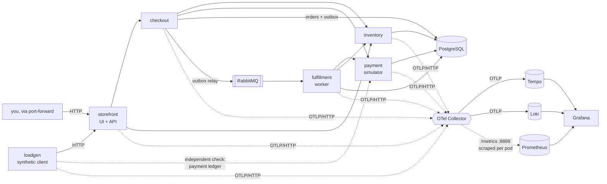
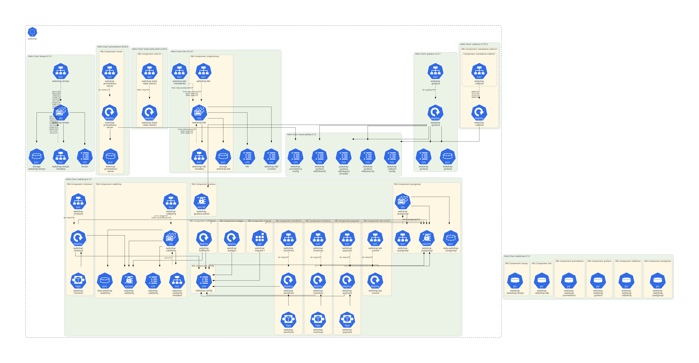

# Webshop observability lab: diagnose incidents from telemetry you already have

> An application is properly instrumented when developers can troubleshoot an
> incident using telemetry already collected, without adding instrumentation
> and reproducing the incident.

This lesson builds a small but honest order-processing system on the AWS
kubeadm cluster, instruments it with OpenTelemetry, ships every signal through
an OpenTelemetry Collector into Prometheus, Loki and Tempo, and then breaks it
in seven repeatable ways (plus one deliberate safeguard bypass). You diagnose
each break in Grafana - first with a walkthrough, then blind, with the
instrumentation frozen.

It is a sibling of the signed `app` chart in [`../`](../README.md): same
cluster, same Helm, different question. The networking lessons ask *how does
a packet get there*; this one asks *how do you know what your users got*.



Solid arrows are application traffic, dotted ones telemetry. `lab-control`, the
internal fault controller every pod polls, is left out of the picture on
purpose: it is not part of the system being observed.

---

**Contents**

1. [Prerequisites](#1-prerequisites)
2. [What gets built](#2-what-gets-built)
3. [Check the cluster before changing it](#3-check-the-cluster-before-changing-it)
4. [Build and publish the image](#4-build-and-publish-the-image)
5. [Storage: prepare the worker](#5-storage-prepare-the-worker)
6. [Metrics API for the HPA](#6-metrics-api-for-the-hpa)
7. [Deploy](#7-deploy)
8. [Verify](#8-verify)
9. [Open the shop and Grafana](#9-open-the-shop-and-grafana)
10. [What each signal contributes](#10-what-each-signal-contributes)
11. [Incident exercises](#11-incident-exercises)
12. [Blind exercises](#12-blind-exercises)
13. [Scaling and capacity](#13-scaling-and-capacity)
14. [Troubleshooting](#14-troubleshooting)
15. [Cleanup](#15-cleanup)
16. [Values reference](#16-values-reference)
17. [Tests](#17-tests)
18. [Layout, versions, and limitations](#18-layout-versions-and-limitations)

---

## 1. Prerequisites

**A running AWS kubeadm lab.** Build it with [`AWS/kubeadm/`](../../../README.md)
(sections 1-7: `terraform apply`, wait for both nodes `ready`, fetch the
kubeconfig) and point `KUBECONFIG` at the file exactly as that README shows.
This lesson never touches the Terraform project or the security group:
everything below reaches the cluster through the API server on 6443.

**On your computer** (Windows, macOS or Linux - nothing here needs Bash, WSL or Git Bash):

| Tool | Why |
|---|---|
| kubectl | talk to the cluster |
| Helm 3.8+ (written against v4.3) | install the chart |
| Python 3.10+ | the `tools/*.py` helpers (standard library only, no packages) |
| Docker with buildx, or Podman | build the application image |
| A container registry account (Docker Hub, GHCR, ...) | the EC2 nodes pull the image from there |

**Command conventions.** Commands run from this `webshop/` directory unless
they say otherwise. `k` is `kubectl`, and the namespace always follows it
(`k -n webshop get pods`). Set the alias once per terminal:

```text
Windows PowerShell:  Set-Alias -Name k -Value kubectl
Windows cmd:         doskey k=kubectl $*
macOS / Linux:       alias k=kubectl
```

`python` below is your Python 3 interpreter: `py` on Windows (the launcher),
often `python3` on macOS and Linux.

Commands marked **[on the worker]** run on the `worker` node: open a shell
with `terraform output session_manager_commands` (or `ssh_commands`) from
`AWS/kubeadm/`, as in that README's section 8.

## 2. What gets built

| Component | Kind | Job |
|---|---|---|
| storefront | Deployment + HPA | Web UI and the JSON API users (and the synthetic client) call |
| checkout | Deployment + HPA (2-3) | Validates, reserves stock, authorizes payment, persists the order and its outbox message in one transaction, answers **202 Accepted**; runs the outbox relay |
| inventory | Deployment + HPA | Catalog, stock, idempotent reservations (order ID = key) |
| payment | Deployment + HPA | Payment simulator: authorize, capture (= charge), void; its own ledger |
| fulfillment | Deployment | RabbitMQ consumer: pick, capture, commit stock, record what shipped |
| loadgen | Deployment | Synthetic client: realistic journeys, judged independently (the SLI) |
| lab-control | Deployment | Internal, lab-only fault and load controller |
| migrate | Job (per revision) | Idempotent schema migration and catalog seed |
| postgresql | StatefulSet | Durable business state (one database, a schema per owning service) |
| rabbitmq | StatefulSet | Durable queue between checkout and fulfillment |
| collector | Deployment (upstream chart) | OTLP in; enrichment; traces to Tempo, logs to Loki, metrics exposed for Prometheus; Kubernetes events to Loki |
| prometheus, kube-state-metrics | upstream chart | Metrics, exemplars, alert rules; Kubernetes object state |
| loki, tempo | upstream charts | Single-process ("monolithic") log and trace stores |
| grafana | upstream chart | Provisioned data sources, links, and dashboards |

One image runs every webshop component (`python -m webshop <component>`).

The same release as Kubernetes objects, drawn from `values/values-aws.yaml`
with [KubeDiagrams](https://github.com/philippemerle/KubeDiagrams) (open the
image for full size):

[](docs/diagrams/kubernetes-aws.png)

Top: the telemetry stack, one box per Helm chart. Middle: the shop, one box
per component. Bottom right: the six local PersistentVolumes - cluster-scoped,
so outside the namespace, each pre-bound to its claim (section 5). Dashed
arrows are Services selecting their pods; solid arrows are workloads using a
ConfigMap, Secret or claim, and autoscalers pointing at their Deployment. Not
drawn: the 22 NetworkPolicies, the RBAC objects and the Helm test pod. To
redraw it after a chart change, run the command at the top of
[docs/diagrams/kube-diagrams.yaml](docs/diagrams/kube-diagrams.yaml).

**An accepted order is not a fulfilled order.** Checkout's 202 means: stock is
held, the card is authorized, and the order and its "please fulfil" message
were committed together (transactional outbox). Fulfilment happens later, in
the worker: it captures the payment, takes the stock, and writes what it
*actually* shipped into a separate shipment record - the customer's original
request is immutable (a database trigger refuses updates). The UI and
`GET /orders/{id}` show the real state: `pending -> accepted -> fulfilling ->
fulfilled` (or `rejected` / `failed`).

**Correctness under retries.** Every call that can be retried is idempotent:
checkout by the client's idempotency key, reservations by order ID,
authorizations and captures by key. The worker acknowledges a message only
after its database commit; a redelivered message for a finished order is
recognised and acknowledged without side effects. The tests in [`tests/`](tests)
exercise each of these against a real PostgreSQL and RabbitMQ.

Deeper explanation of the instrumentation: **[docs/observability.md](docs/observability.md)**.

## 3. Check the cluster before changing it

Confirm you are pointed at the lab, not at some other cluster:

```text
k config current-context
k get nodes -o wide
```

Expect `kubernetes-admin@kubernetes` (the kubeadm default the lab publishes)
and two nodes, `master` and `worker`, `Ready`. Then look at what you are
deploying into - the chart's defaults were budgeted against exactly this:

```text
k describe node worker
k get node master -o jsonpath="{.spec.taints}"
k get storageclass
k get apiservice v1beta1.metrics.k8s.io
k get ingressclass
k get gatewayclass
```

| Question | Lab answer | Consequence |
|---|---|---|
| Worker allocatable | 2 CPU, ~3.7 GiB (t3.medium) | everything must fit here (section 13) |
| Master taint | `node-role.kubernetes.io/control-plane:NoSchedule` | kept: nothing in this lesson tolerates it |
| StorageClass | none ("No resources found") | durable components use local PVs (section 5) |
| Metrics API | absent until you install metrics-server | the HPA needs it (section 6) |
| Ingress/Gateway | only if you left Module 6/7 installed | port-forwarding is the default way in |

If the existing three-tier app from the networking lessons is deployed, it can
stay: it lives in its own namespace and requests 125m CPU and 160 Mi in total
(five pods at 25m / 32 Mi), well inside the headroom below.

## 4. Build and publish the image

Building on your workstation does not put the image on the EC2 nodes: their
containerd pulls it from a registry, like any other image. Build for
`linux/amd64` (the nodes are x86_64, even if your laptop is ARM) and push:

```text
docker login
python tools/images.py build --registry docker.io/<your-user> --tag 0.1.0 --push
```

(Podman works too: `--tool podman`. The equivalent raw command is
`docker buildx build --platform linux/amd64 -t docker.io/<your-user>/webshop:0.1.0 --push src`.)

A **public** repository needs nothing else. For a **private** one, give the
nodes a pull credential and reference it:

```text
k create namespace webshop
k -n webshop create secret docker-registry regcred --docker-server=https://index.docker.io/v1/ --docker-username=<your-user> --docker-password=<access-token>
```

and add `--set imagePullSecrets[0].name=regcred` to the install below. Use an
access token, not your password. Every new image gets a new tag; to pin
exactly what runs, set `image.digest` (`sha256:...`).

## 5. Storage: prepare the worker

The lab has no dynamic volume provisioner, so a PersistentVolumeClaim against
a StorageClass would stay `Pending` forever. Instead, `values/values-aws.yaml`
sets `storage.mode: localPV`: the chart creates one local PersistentVolume per
durable component, pinned to the `worker` node and pre-bound to the claim that
component will make. The directories must exist first, on the worker.

Open a shell on the worker with Session Manager (the default - no SSH, no
open ports) or with SSH (only if you set `ssh_enabled = true`; see
[AWS/kubeadm/README.md, section 8](../../../README.md#8-shell-access-to-the-nodes)).
From the `AWS/kubeadm` directory, print the ready-made commands:

```text
terraform output session_manager_commands
terraform output ssh_commands
```

Run the `worker` entry from either list, for example
`aws ssm start-session --target i-0abc... --region us-east-1` or
`ssh -i ~/.ssh/id_ed25519 ubuntu@<worker-public-ip>`. Session Manager logs
you in as `ssm-user`, SSH as `ubuntu`; both may use `sudo`. Then, **on the
worker**:

```bash
sudo mkdir -p /var/lib/webshop/postgresql /var/lib/webshop/rabbitmq /var/lib/webshop/prometheus /var/lib/webshop/loki /var/lib/webshop/tempo /var/lib/webshop/grafana
ls -ld /var/lib/webshop/*
exit
```

No `chown` is needed: each pod sets an `fsGroup`, and the kubelet makes the
local volume group-writable for it (PostgreSQL keeps its data in a
subdirectory it creates itself, which is why `initdb` accepts the ownership).

What this storage does and does not survive:

| Event | Data |
|---|---|
| pod restart, rescheduling (the pod follows its volume to `worker`) | kept |
| `helm uninstall` (PVs, generated Secrets and PVCs are kept on purpose) | kept |
| deleting the PVs and the directories (section 15) | gone |
| rebuilding the lab (`terraform destroy`/`apply`: new root EBS volume) | gone |

Clusters with a provisioner can use `storage.mode: storageClass`. A quick,
throwaway try can skip all of this with the overlay
`-f values/values-ephemeral.yaml` (emptyDir everywhere: nothing survives a pod
restart).

## 6. Metrics API for the HPA

`kubectl autoscale`-style CPU scaling reads the resource metrics API
(`metrics.k8s.io`), which **metrics-server** provides - not Prometheus.
`k get apiservice v1beta1.metrics.k8s.io` tells you whether it exists. If it
does not, install it once, into `kube-system`, as a cluster component in its
own Helm release (so uninstalling the webshop never takes it away from
anything else):

```text
helm upgrade --install metrics-server metrics-server --repo https://kubernetes-sigs.github.io/metrics-server/ --version 3.14.0 -n kube-system --set "args[0]=--kubelet-insecure-tls"
k top nodes
```

`--kubelet-insecure-tls` because kubeadm's kubelet serving certificates are
self-signed; the production fix is `serverTLSBootstrap: true` plus approving
the kubelets' CSRs.

## 7. Deploy

Fetch the pinned dependency charts (exact versions are in `chart/Chart.lock`):

```text
helm repo add open-telemetry https://open-telemetry.github.io/opentelemetry-helm-charts
helm repo add prometheus-community https://prometheus-community.github.io/helm-charts
helm repo add grafana-community https://grafana-community.github.io/helm-charts
helm dependency build ./chart
```

`dependency build` also repackages the local [`observability/`](observability)
chart (Collector, Prometheus and Grafana configuration) - re-run it whenever
you edit anything there.

Render first, then install:

```text
helm lint ./chart -f values/values-aws.yaml
helm upgrade --install webshop ./chart -n webshop --create-namespace -f values/values-aws.yaml --set image.repository=<your-user>/webshop --dry-run=server
helm upgrade --install webshop ./chart -n webshop --create-namespace -f values/values-aws.yaml --set image.repository=<your-user>/webshop
k -n webshop get pods -w
```

The first start takes 3-5 minutes (image pulls, PostgreSQL `initdb`, the
migration Job). Services wait for the database and the schema before they
report ready; nothing crash-loops while they wait.

## 8. Verify

```text
helm test webshop -n webshop --logs
python tools/lab.py verify
```

`helm test` places one real order and judges it by the SLI rules (next
section). `verify` then checks the whole telemetry path with that order (it
first gives pods that are still starting up to two minutes - right after an
install the HPAs briefly add replicas):

| Check | What it proves |
|---|---|
| pods, NetworkPolicies, metrics.k8s.io | running under default-deny; HPA has its metrics API |
| synthetic journey | fulfilled with the requested item, charged exactly once, within 5 s |
| Prometheus targets, app metrics, instance identity | every Collector pod, exporter, kubelet and backend scraped; one series set per pod |
| exemplars, exemplar -> Tempo | histogram observations carry trace IDs that resolve in Tempo |
| journey trace, context across the queue | one trace spans all six services; `order.fulfill` is a child of `order.publish` |
| Tempo search by order ID; Loki logs for the order | investigation by order ID works in both stores |
| logs carry the trace ID; order ID is structured metadata | Loki -> Tempo and Tempo -> Loki links have something to join on; Loki's index stays small |
| Kubernetes events in Loki; alert rules; Collector export failures | infra signals and pipeline health are collected |
| Grafana data sources, links, dashboards | provisioning worked |

`python tools/lab.py check-dashboards` additionally runs every dashboard
query against the live stores and reports any that error.

## 9. Open the shop and Grafana

In two terminals:

```text
k -n webshop port-forward svc/webshop-storefront 8080:80
k -n webshop port-forward svc/webshop-grafana 3000:80
```

- <http://localhost:8080> - pick a product **and a color**, check out, and
  watch the order move from *accepted* to *fulfilled*. The page compares what
  you ordered with what shipped.
- <http://localhost:3000> - Grafana. Anonymous access is an Editor (local,
  port-forward only; turn it off in `grafana.grafana.ini` before exposing it).
  The admin username is `admin`; the password is generated on the first
  install and kept in the `webshop-grafana-admin` Secret. In any shell
  (PowerShell, Command Prompt, macOS, Linux):

```text
python tools/lab.py grafana-password
```

On Linux or macOS you can also read both values straight from the Secret:

```bash
k -n webshop get secret webshop-grafana-admin -o jsonpath='{.data.admin-user}' | base64 --decode; echo
k -n webshop get secret webshop-grafana-admin -o jsonpath='{.data.admin-password}' | base64 --decode; echo
```

The **Webshop** folder holds six dashboards. Start at the top one:

| Dashboard | Question it answers |
|---|---|
| User reliability | Are customers getting what they paid for, on time, charged once? (SLI/SLO, bad journeys by reason, duplicate charges, journey latency with exemplars) |
| Service health | Which service, route, pod, or dependency? (RED, per-pod comparison, retries/amplification, saturation) |
| Kubernetes and scaling | Is it the platform? (CPU vs limits, throttling, restarts, readiness, HPA desired/current, events) |
| Database and queue | Pool pressure or slow SQL? Backlog, oldest message, waiting vs processing, outbox |
| Telemetry health | Can you trust the other dashboards? (Collector accepted/refused/failed, queues, SDK drops, backend ingestion) |
| Order investigation | Everything about one order ID: every log line from every service, and its traces |

The three links between signals, all provisioned:

- **metrics -> trace**: on a latency panel, each exemplar dot is one
  observation; click it to open *that* request's trace. A percentile line is
  an aggregate of thousands of requests; the exemplar is one representative,
  not an explanation of all of them.
- **trace -> logs**: from any span, "Logs for this span" opens every log record
  of that trace, across services.
- **logs -> trace**: any log line written inside a span carries `trace_id`;
  expanding it shows an *Open trace* link.

## 10. What each signal contributes

| Signal | Good at | Bad at |
|---|---|---|
| Metrics | Is something wrong, how much, since when, where (service, route, pod, version)? Cheap to keep, fast to aggregate, drives alerts | Why one particular request was slow; anything high-cardinality |
| Traces | Where the time went in *one* request across services; causal order; retries as separate attempts; the queue hop | Rates and trends (they are samples of individual requests) |
| Logs | What the code decided and why: business events (order accepted, shipped variant), error details, exception stacks | Aggregation; volume makes them expensive |
| Kubernetes metrics and events | What the platform did: throttling, restarts and their exit codes, rescheduling, HPA decisions | Anything about application meaning; even the cause of a kill can be vague (an OOM kill recorded as `Error`, exit 137 - [docs/observability.md](docs/observability.md) section 6) |

They join on shared identifiers: `service.name`, `service.instance.id` (the pod
name), `trace_id`, and the business key `webshop.order.id` - IDs live on spans
and log records, never on metric labels.

**Why the synthetic client checks outcomes itself.** In the
incorrect-fulfillment exercise every HTTP call succeeds and every order reaches
`fulfilled`: RED dashboards stay green. The only thing that notices is a
client that remembers it ordered *Crimson* and compares that with what
shipped, and that counts charges in the payment simulator's own ledger instead
of trusting the order record. The SLI, exactly:

> **Eligible journey:** a synthetic purchase of a catalog variant (quantity
> 1-5, approved test card) that the client submitted. **Good** iff: checkout
> answered with an order ID; the order reached `fulfilled` within **5 s** of
> submission; the shipped SKU equals the SKU the client *remembers*
> requesting; the payment ledger shows **exactly one** successful capture, for
> the right amount. Each journey is evaluated **once**, at completion or at the
> deadline - still pending at the deadline is bad. **SLO: 99%** of eligible
> journeys (illustrative).

Deliberately invalid requests (declined card, quantity 0) are *validation
checks* with an expected rejection, counted separately and outside the
denominator. Details, and how a production SLO would differ:
[docs/observability.md](docs/observability.md).

## 11. Incident exercises

Faults are **off by default**. `lab-control` holds them in memory (a pod
restart clears them), every pod polls it every 2 s through an uninstrumented
client, and the faults leave no trace in telemetry except their effects - no
"fault injected" log lines, no tell-tale span names. Each walkthrough says
what the user sees, where to start, the exact queries, the evidence, and how
to confirm recovery.

| # | Exercise | Start it | Walkthrough |
|---|---|---|---|
| 1 | Slow inventory | `python tools/lab.py fault apply slow-inventory` | [docs/incidents/01-slow-inventory.md](docs/incidents/01-slow-inventory.md) |
| 2 | Exhausted database pool | `python tools/lab.py fault apply pool-exhaustion` | [02-pool-exhaustion.md](docs/incidents/02-pool-exhaustion.md) |
| 3 | Retry amplification | `python tools/lab.py fault apply retry-amplification` | [03-retry-amplification.md](docs/incidents/03-retry-amplification.md) |
| 4 | Bad replica | `python tools/lab.py fault apply bad-replica` | [04-bad-replica.md](docs/incidents/04-bad-replica.md) |
| 5 | Incorrect fulfillment | `python tools/lab.py fault apply wrong-fulfillment` | [05-incorrect-fulfillment.md](docs/incidents/05-incorrect-fulfillment.md) |
| 6 | Insufficient capacity | `python tools/lab.py fault apply traffic-surge` | [06-insufficient-capacity.md](docs/incidents/06-insufficient-capacity.md) |
| 7 | Worker backlog | `python tools/lab.py fault apply worker-backlog` | [07-worker-backlog.md](docs/incidents/07-worker-backlog.md) |
| 8 | Duplicate charges (**safeguard bypass**) | `python tools/lab.py fault apply duplicate-charges --yes` | [08-duplicate-charges.md](docs/incidents/08-duplicate-charges.md) |

End any of them with `python tools/lab.py fault reset` (also resets the load).
`fault list`, `--duration 600` (auto-expiry), `--replica N` / `--instance POD`
(one pod only) and `--param k=v` (override a parameter) work on every preset.

Exercise 8 is different in kind: the healthy system *cannot* double-charge,
because retries reuse their idempotency key. The preset explicitly switches
that safeguard off (fresh keys on every retry) to show what the independent
checks catch. It refuses to run without `--yes`.

## 12. Blind exercises

The real test. A random combination of two or more faults starts at a random
moment; you diagnose it from Grafana alone, with the instrumentation frozen:

```text
python tools/lab.py blind start
python tools/lab.py blind reveal
python tools/lab.py blind stop
```

Rules, report template and scoring: **[docs/blind-exercises.md](docs/blind-exercises.md)**.
The answers are in `docs/answer-key/` - do not open it first. `reveal`
compares a fingerprint of every workload template and telemetry ConfigMap with
the one taken at `start`: if you had to add logs, spans or metrics to find the
cause, that is an instrumentation gap, and it should be written down as one.

## 13. Scaling and capacity

**State and identity across replicas.** No pod holds business state: orders,
reservations, payments and messages live in PostgreSQL and RabbitMQ, so any
replica can serve any request and a replica can die mid-order (the order is
then rejected and compensated by the pending-order sweeper, or completed by
message redelivery). Each replica is its own `service.instance.id` (its pod
name), so Prometheus keeps one series set per pod and the per-pod panels can
compare replicas. Scale by hand:

```text
k -n webshop scale deploy/webshop-fulfillment --replicas=2
```

checkout, storefront, inventory and payment scale with their HPAs
(`k -n webshop get hpa`); edit `components.<name>.autoscaling` to change the
bounds. **Single-instance by design in this profile:** PostgreSQL, RabbitMQ,
Prometheus, Loki, Tempo, Grafana and the Collector. Making those highly
available is a different project (operators or managed services, replication,
object storage) and is out of scope; the application tier scales independently
of them.

**Capacity budget** (requests from the rendered `values-aws.yaml`; usage
measured at 1 journey/s on the AWS lab, where payment and storefront settle at
two replicas each - their HPAs see ~40% of a small CPU request):

| | CPU | Memory |
|---|---|---|
| Worker allocatable (t3.medium) | 2000m | ~3.6 GiB |
| System pods already on the worker (Calico, kube-proxy, metrics-server) | ~100m | ~200 Mi |
| Webshop requests at minimum replicas | 1135m | 2248 Mi |
| Webshop requests with every HPA at its maximum | 1385m | 2648 Mi |
| Webshop actual usage at 1 journey/s, measured on the AWS lab | ~430m | ~1.7 GiB |

Limits add up to more than the node (7.5 CPU, 5.4 GiB at minimum replicas):
they are ceilings for bursts, and on a two-vCPU node the CPU limits are what
make saturation and throttling observable in exercise 6. `t3` instances are
burstable: sustained high CPU there spends CPU credits (unlimited mode bills
the surplus), one more reason to keep the capacity exercise short.

**Telemetry and data volume.** Every trace is kept (no sampling). Measured on
the lab-shaped cluster over 22 minutes of steady traffic at the default rate
(0.9 evaluated journeys/s plus validation checks, no faults):

| Store | Grows by | Kept | Size at the limit | Volume |
|---|---|---|---|---|
| Tempo: ~70 spans/s, ~78 per journey, 6 million a day | ~570 MiB/day | 48 h | ~1.3 GiB (blocks, plus compacted blocks awaiting cleanup) | 5 Gi |
| Prometheus: ~30k series, ~1,000 samples/s | ~180 MiB/day | 3 days or 2 GB | ~0.7 GiB (including ~120 MiB of WAL) | 3 Gi |
| Loki: ~9 records/s | ~30-40 MiB/day | 72 h | ~0.1 GiB | 3 Gi |
| PostgreSQL: ~2.5 KB per order, nothing pruned | ~200 MiB/day | forever | 2 Gi after ~9 days | 2 Gi |
| RabbitMQ (the queue drains), Grafana | flat | - | a few MiB | 1 Gi, 512 Mi |

The volumes leave room for exercises at many times the default rate - but a
fault or load change without `--duration` stays until you reset it, and at
exercise 6's 30 journeys/s traces alone would grow by more than 15 GiB a day.
Local volumes do not enforce their size: everything shares the worker's 30 GB
root disk (`sudo du -sh /var/lib/webshop/*` **[on the worker]**). To start
PostgreSQL afresh, remove its volume as in section 15. At higher scale you
would sample (tail-based sampling in a Collector tier that sees whole traces,
keeping all errors and slow traces), shorten retention, and move the stores to
object storage - see [docs/observability.md](docs/observability.md).

**Scaling the telemetry path.** The Collector runs as one replica on purpose:
its Prometheus exporter holds the series it received, and Prometheus scrapes
each Collector *pod* (never the Service, which would alternate between pods
holding different series). Scaling the gateway would need either node-local
agents (a DaemonSet each pod sends to) or the load-balancing exporter keyed by
`service.instance.id`, so one app instance's series always land on the same
Collector.

**Existing backends instead.** If you already run PostgreSQL, RabbitMQ, or a
telemetry stack, [`values/values-existing-backends.yaml`](values/values-existing-backends.yaml)
switches every bundled backend off and wires connections and credentials
through Secret references (the Collector stays, exporting to your Tempo, Loki
and Prometheus with auth headers from a Secret).

**Optional ways in.** Port-forwarding needs nothing installed and goes through
the API server, the only port the lab's security group opens. If you kept the
ingress-nginx (Module 6) or Envoy Gateway (Module 7) controller, the chart can
attach to it: `exposure.ingress.enabled` (class `nginx`, host `webshop.local`)
or `exposure.httpRoute.enabled` with `parentRefs` naming a Gateway, plus that
controller's namespace in `networkPolicy.ingressControllerNamespaces`. Module
7's `app-gateway` only admits routes from its own namespace
(`allowedRoutes.namespaces.from: Same`), so an HTTPRoute in `webshop` needs a
Gateway (or listener) of your own that allows it - the lesson's resources are
left as they are. Only the storefront and Grafana are ever exposed; the
controllers' NodePorts are still reachable only from the nodes, as in Module 5.

## 14. Troubleshooting

| Symptom | Cause and fix |
|---|---|
| Pods `Pending`, events say `didn't find available persistent volumes` / `node(s) didn't match PersistentVolume's node affinity` | `storage.localPV.nodeName` does not match the node's name, or a PV is `Released` from an earlier install (section 15) |
| Right after install: `ProvisioningFailed ... storageclass.storage.k8s.io "webshop-local" not found` and `FailedScheduling ... unbound immediate PersistentVolumeClaims` | harmless if it clears within seconds: a claim was seen just before its pre-created volume and binds on the controller's next pass. There is deliberately no StorageClass object (nothing could provision). If it persists, a PV is missing or `Released` (`k get pv`) |
| Pod stuck `ContainerCreating`, event `MountVolume.NewMounter ... path "/var/lib/webshop/..." does not exist` | create the directories on the worker (section 5) |
| A StatefulSet pod (`webshop-postgresql-0`, `webshop-rabbitmq-0`) keeps crash-looping after the `helm upgrade` that should fix it | a StatefulSet rolling update waits for the old pod to become Ready, so a crashing one is never replaced: `k -n webshop delete pod webshop-rabbitmq-0` |
| A backend pod restarts; alert `ContainerRestarted` or `ContainerNearMemoryLimit` | `k -n webshop describe pod <pod>` (*Last State*). Exit code 137 is SIGKILL - usually the memory limit, even when the reason says `Error`; raise that component's `resources.limits.memory` |
| `ImagePullBackOff` | wrong `image.repository`, a private repository without `imagePullSecrets`, or an arm64-only image (rebuild with `--platform linux/amd64`) |
| A service stays `0/1 Running` | it is waiting: `k -n webshop logs deploy/webshop-checkout` says for what (database, schema migration, catalog, broker) |
| HPA shows `<unknown>` targets | no metrics API (section 6) |
| Grafana panels empty everywhere | check *Telemetry health* first; then `python tools/lab.py verify` |
| Collector or Prometheus targets down after you narrowed NetworkPolicy CIDRs | `networkPolicy.apiServer` must contain the control plane's real address and `networkPolicy.kubelet` the nodes (policies apply after the Service IP is rewritten) |
| Collector still uses an old pipeline after editing `observability/` | re-run `helm dependency build ./chart` before `helm upgrade` (the Collector restarts on every upgrade) |
| Data source change not visible in Grafana | `k -n webshop rollout restart deploy/webshop-grafana` (dashboards reload by themselves within 30 s) |
| Grafana rejects the admin password from `python tools/lab.py grafana-password` | Grafana stores the password in its database on first start; if the kept `webshop-grafana-admin` Secret was deleted but the Grafana volume was not, they disagree. Reset it: `k -n webshop exec deploy/webshop-grafana -c grafana -- grafana cli --homepath /usr/share/grafana admin reset-admin-password <password>` |
| `helm dependency build` says `no repository definition` | add the three repos (section 7) |

## 15. Cleanup

Remove the release and everything it owns in the namespace:

```text
python tools/lab.py fault reset
helm uninstall webshop -n webshop
k delete namespace webshop
```

Left behind on purpose, so a reinstall finds its data: the six local
PersistentVolumes (`helm.sh/resource-policy: keep`) and the data in
`/var/lib/webshop` on the worker. After deleting the namespace those PVs are
`Released` and will not bind again; delete them deliberately:

```text
k get pv -l app.kubernetes.io/instance=webshop
k delete pv -l app.kubernetes.io/instance=webshop
```

then the data itself **[on the worker]**:

```bash
sudo rm -rf /var/lib/webshop
```

metrics-server (section 6) is a shared cluster component: remove it only if
you installed it and nothing else uses it
(`helm uninstall metrics-server -n kube-system`). The image stays in your
registry. Nothing here touches the networking lessons' `three-tier`
namespace, shared controllers, or AWS. To remove the whole disposable cluster,
see [AWS/kubeadm/README.md, section 10](../../../README.md#10-destroy).

## 16. Values reference

All values with comments: [`chart/values.yaml`](chart/values.yaml). The ones
you are most likely to change:

| Value | Default | Purpose |
|---|---|---|
| `image.registry` / `image.repository` / `image.tag` / `image.digest` | `docker.io` / `CHANGE-ME/webshop` / `0.1.0` / `""` | where the nodes pull the webshop image |
| `imagePullSecrets` | `[]` | e.g. `[{name: regcred}]` |
| `global.webshop.environment` / `clusterName` | `lab` / `kubernetes` | `deployment.environment.name`, `k8s.cluster.name` on every signal |
| `components.<name>.replicas` / `.resources` / `.autoscaling` | see file | sizing and HPA bounds per component |
| `app.*` | pool 5, timeouts 2 s / 1.5 s, attempts 2 / 3 | dependency policy; changes the config revision |
| `app.httpKeepalive` | `false` | `true` reuses connections between services - and lets kube-proxy pin a caller's traffic to one replica (connection-level balancing) |
| `dnsConfig` | `ndots: 2` | pod DNS options for the webshop's pods; `{}` restores the cluster default (`ndots:5`: every service lookup walks the search list first) |
| `synthetic.ratePerSecond` / `deadlineSeconds` / `validationRatio` | `1.0` / `5` / `0.05` | the synthetic client and the SLI deadline |
| `labControl.enabled` | `true` | the fault controller (faults are still off until set) |
| `storage.mode` | `storageClass` (`localPV` in values-aws) | `storageClass` / `localPV` / `ephemeral` |
| `storage.localPV.nodeName` / `basePath` | `worker` / `/var/lib/webshop` | where local PVs live |
| `networkPolicy.enabled` | `true` | default-deny plus per-flow allow-lists |
| `networkPolicy.apiServer.cidrs` / `kubelet.cidrs` | `0.0.0.0/0` (aws: `10.0.1.10/32`, `10.0.1.0/24`) | egress for API and kubelet access |
| `postgresql.enabled` / `rabbitmq.enabled` + `external.*` + `existingSecret` | bundled | use existing servers |
| `otel.endpoint` / `otel.headersSecret` | bundled Collector | send app telemetry elsewhere |
| `observability.collector.{traces,logs,metrics}.*` | in-release backends | where the Collector exports (existing stack) |
| `observability.alerts.sloTarget` | `0.99` | SLO used by the burn-rate alert |
| `collector.enabled` / `prometheus.enabled` / `loki.enabled` / `tempo.enabled` / `grafana.enabled` | `true` | bundled telemetry components |
| `exposure.ingress.*` / `exposure.httpRoute.*` | disabled | optional Ingress / HTTPRoute for the storefront (and Grafana) |

## 17. Tests

```text
python -m venv .venv
.venv\Scripts\activate          (Windows)      source .venv/bin/activate   (macOS / Linux)
pip install --no-deps -r src/requirements.txt
pip install -r src/requirements-dev.txt
python -m pytest
```

Unit tests need nothing else. The integration tests (`tests/test_integration.py`:
accepted vs fulfilled, idempotent checkout/reservations/captures, redelivery
after a crash, the outbox under concurrent relays, trace continuity across the
queue, the immutable request) need a PostgreSQL and a RabbitMQ; with Docker:

```text
docker run -d --name webshop-test-pg -p 15432:5432 -e POSTGRES_USER=webshop -e POSTGRES_PASSWORD=webshop -e POSTGRES_DB=webshop postgres:17.11-trixie
docker run -d --name webshop-test-mq -p 15672:5672 rabbitmq:4.3.6
```

then set `WEBSHOP_TEST_PGHOST=localhost`, `WEBSHOP_TEST_PGPORT=15432`,
`WEBSHOP_TEST_PGUSER=webshop`, `WEBSHOP_TEST_PGPASSWORD=webshop`,
`WEBSHOP_TEST_AMQP_HOST=localhost`, `WEBSHOP_TEST_AMQP_PORT=15672` (PowerShell
`$env:NAME="value"`, cmd `set NAME=value`) and run `python -m pytest` again.
Without them those tests are skipped and say why.

## 18. Layout, versions, and limitations

```text
webshop/
├── README.md                this lesson
├── src/                     the application (one Python package, one Dockerfile)
├── chart/                   the Helm chart, Chart.lock, templates
├── observability/           local chart: Collector pipeline, Prometheus config + alert rules,
│                            Grafana data sources + dashboards (built by tools/build_dashboards.py)
├── values/                  values-aws.yaml (primary), values-existing-backends.yaml,
│                            values-ephemeral.yaml (overlay), values-kind.yaml (optional)
├── tools/                   lab.py (faults, load, blind, verify), images.py, kind_cluster.py, build_dashboards.py
├── tests/                   pytest: SLI, retries, propagation, lab-control, single export,
│                            dashboards in sync, integration (PostgreSQL + RabbitMQ)
└── docs/                    observability.md, incidents/, blind-exercises.md, answer-key/, verification.md,
                             diagrams/ (the Kubernetes diagram and its KubeDiagrams config)
```

**Pinned versions:** Python 3.13.16 (slim), OpenTelemetry Python 1.45.0 /
instrumentation 0.66b0, FastAPI 0.142.2, asyncpg 0.31.0, aio-pika 10.1.0;
PostgreSQL 17.11, RabbitMQ 4.3.6, postgres_exporter 0.20.1; OpenTelemetry
Collector contrib 0.161.0 (chart 0.175.0), Prometheus 3.15.0 (chart 29.35.0,
kube-state-metrics 2.20.0), Loki 3.7.8 (chart 18.13.7), Tempo 3.1.0 (chart
3.1.0), Grafana 13.2.3 (chart 13.2.7) - the Grafana, Loki and Tempo charts come
from the community-maintained `grafana-community` repository, where they moved
in 2026. metrics-server chart 3.14.0. Every Python dependency, direct and
transitive, is pinned in `src/requirements.txt`.

**Where it was verified:** [docs/verification.md](docs/verification.md) lists
every check run, on what, and with what result - on a Kind cluster shaped
like the lab, then on the AWS lab itself.

**Limitations, honestly:**

- Single-instance data and telemetry stores; no backups; local volumes share
  the worker's root disk. This is a lab profile.
- PostgreSQL keeps every order - nothing prunes it (~200 MiB a day at the
  default rate, section 13). Telemetry stores are bounded by retention.
- The numbers quoted in the walkthroughs come from one run each on a
  lab-shaped Kind cluster; the AWS lab showed the same evidence with healthy
  latencies 3-6x higher, and two differences in kind, both described where
  they occur (exercise 6 never recovers during the surge; blind B1's queue
  grows). Expect your numbers to differ, not the shape of the evidence.
- Faults are simulated in the application (delays, errors, timeouts, held
  connections, a wrong variant), not real infrastructure failures. Their
  *effects* are real and measured the same way real ones would be.
- The SLI comes from one synthetic client with a 0.4 s polling interval, so
  measured completion times are upper bounds within 0.4 s; journeys in flight
  when the load generator restarts are never evaluated.
- The queue-wait span is reconstructed from the publish timestamp, so it
  depends on node clocks being in sync (they are, on EC2).
- `lab-control` is unauthenticated (reachable only by port-forward and by the
  webshop's own pods) and in-memory by design.
- Anonymous Grafana Editor access is a lab convenience.
